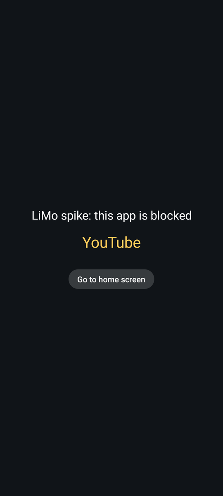
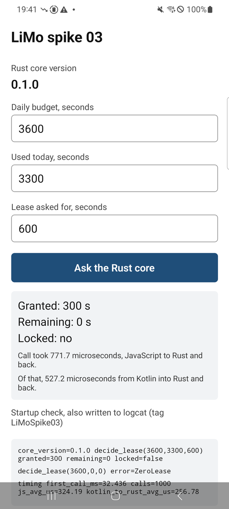
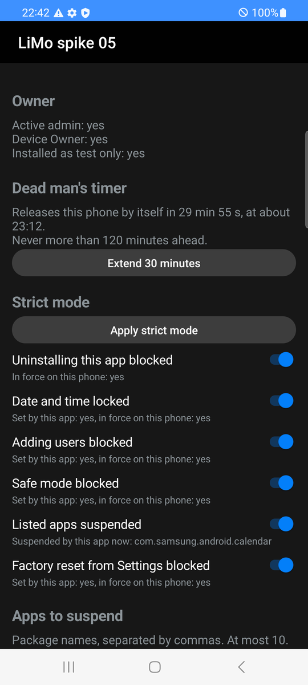
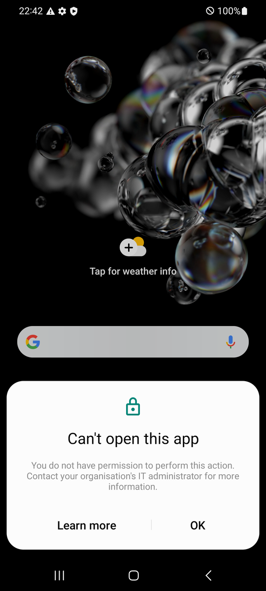

<p align="center">
  <a href="https://lucidloom.ai">
    
  </a>
</p>

<p align="center">
  <b><a href="https://lucidloom.ai">LucidLoom AI</a></b><br>
  Intelligent infrastructure for education
</p>

<h1 align="center">LiMo</h1>

<p align="center">
  <b>Limit Monitor</b>: screen time limits for children, on the family's own PC and phones.<br>
  Free and open source. No server, no account, nothing leaves the home.
</p>

---

## What LiMo is

LiMo is being built to help a family limit how long a child uses a Windows PC
and an Android phone. A guardian sets a daily budget and the hours that are
off limits. LiMo counts the time used across the child's devices, warns before
the time runs out, and locks the screen when it does.

It is made by [LucidLoom AI](https://lucidloom.ai) and given away free, under
the Apache 2.0 licence.

## Where it stands

**LiMo is not ready to install yet.** Before building the product we wrote
small proofs and ran each one on real hardware, to find out what Windows and
Android really allow. Five ran on 17 Nov 2026 and a sixth on 18 Nov 2026.
This repository holds those proofs, with what each one showed, and the first
parts of the product.

## How it will work

- **One master PC.** Every family has one Windows PC that runs LiMo. It
  enforces the limits on itself, keeps the family's rules and usage, and is
  where the guardian sets things up.
- **Phones talk only to that PC, and only on the home Wi-Fi.** There is no
  LiMo server anywhere. A phone that is away from home keeps a share of the
  day's time and settles up when it comes back.
- **One set of rules.** The code that decides how much time is left is written
  once, in Rust, and used on both Windows and Android.
- **Two forms of one phone app.** The child's form is installed from the
  master PC over a USB cable. The guardian's form is installed by tapping it.
- **Strict mode for phones that allow it.** LiMo becomes the Device Owner of
  the child's phone, so it cannot simply be uninstalled. A guardian can always
  release the phone again.

## What LiMo will not do

- It takes no screenshots and reads nothing that is typed. It records which
  app was used and for how long, and nothing else.
- It sends nothing to LucidLoom or to anyone else. The family's data stays on
  the family's own devices.
- It needs no account and no sign in.

## Screenshots from the proofs

These are the plain test screens the proofs use, not the finished product.

<table>
  <tr>
    <td align="center" width="50%">
      
    </td>
    <td align="center" width="50%">
      
    </td>
  </tr>
  <tr>
    <td align="center">
      <b>A blocked app is covered.</b><br>
      On a Galaxy S20 Ultra the cover landed between 25 and 226 thousandths of
      a second after the app came to the front.
    </td>
    <td align="center">
      <b>The phone app asks the Rust rules code.</b><br>
      The same Rust code passes its tests on Windows and answers from inside
      the phone app.
    </td>
  </tr>
  <tr>
    <td align="center">
      
    </td>
    <td align="center">
      
    </td>
  </tr>
  <tr>
    <td align="center">
      <b>Strict mode, with its way out on the same screen.</b><br>
      The test app owns the phone, and a timer releases the phone by itself
      if nobody does.
    </td>
    <td align="center">
      <b>What a child sees in strict mode.</b><br>
      A blocked app cannot be opened at all. The wording is Samsung's own;
      the product will use plain family words.
    </td>
  </tr>
</table>

## What the proofs showed

| Proof | Question | What we saw |
| --- | --- | --- |
| [1. Windows service and lock](spikes/01-windows-service-lock/) | Can a Windows service lock every monitor, and can a child's account stop it? | It locks both monitors and stays above other always on top windows. A standard account could not stop it, end it or change its files. The lock itself runs as the child, protected by Windows, so no program with full rights draws on the child's screen. |
| [2. Android base protection](spikes/02-android-base-lock/) | Without owning the phone, can LiMo cover a blocked app fast enough? | Yes, in well under a second, without reading the screen. But Force stop in Settings switches it off, and Google Play Protect refuses to install such an app when its file is tapped. An install from the PC over USB works. |
| [3. One Rust core](spikes/03-expo-rust-core/) | Can the phone app call the same Rust rules code that Windows uses? | Yes. The Rust part adds about 3 percent to the app, and a call takes less than a thousandth of a second. |
| [4. Finding the PC](spikes/04-lan-discovery/) | Can a phone find the master PC on home Wi-Fi by itself? | Yes, in about a quarter of a second, once the Windows Firewall allows the program. The installer will add its own narrow firewall rule, so a family never has to answer a prompt. |
| [5. Strict mode](spikes/05-strict-mode/) | Can the PC make LiMo the owner of the phone over USB, and can it always be released? | Setup worked every time on a phone with no accounts. Three ways out were built and tested first: a release with the guardian's PIN, a timer that releases the phone by itself, and a forced release from the PC. With strict mode on, uninstalling, factory reset from Settings and changing the clock were refused, it all survived a restart, and a release put everything back. |
| [6. The console window](spikes/06-console-window/) | Can the guardian's window on the PC show the phone app's own screens, so they are built once? | Yes. The same screens run in a small window, get their figures from Rust, and are on screen about a third of a second after the program starts. The program is under 5 MB. The window is drawn by Microsoft's WebView2, which is part of Windows 11 and is not open source. The page fetched nothing, but WebView2 opened one connection to a Microsoft address by itself. What it sends is not yet known, and it has to be settled before this is used. |

Each folder has a `README.md` that says what was built and what was found,
and a `TESTING.md` with the exact steps that were run.

## What is in this repository

```
core/                        Rust: the rules core, the first part of the product
hub/                         Rust: the family's database on the master PC
agent/                       Rust: the engine of the agent on the master PC
windows/                     Rust: the Windows service around the engine, and its helper
design/                      the Paper and Ink theme and LiMo's icons
spikes/
  01-windows-service-lock/   Rust: a Windows service and a lock on every monitor
  02-android-base-lock/      Kotlin: an accessibility service that covers a blocked app
  03-expo-rust-core/         Rust and Expo: one rules crate called from a phone app
  04-lan-discovery/          Rust and Kotlin: a phone finds the PC on home Wi-Fi
  05-strict-mode/            Kotlin and Rust: Device Owner set up over USB, and released
  06-console-window/         Expo and Rust: the phone app's screens in a window on the PC
docs/images/                 the pictures on this page
LICENSE                      Apache 2.0
```

The proofs are small on purpose and are not the product. Each one can be
built by following its own README. They need Rust, the Android SDK and JDK 17;
the third and the sixth also need Node.

The product has begun with [`core/`](core/): one Rust library that holds the
time rules and keeps one daily budget honest across a PC and a phone with no
server. Windows and Android will both use it. Its README explains the model
in plain words, and its tests include a file of cases anyone can read.

[`hub/`](hub/) is the second part: the family's database on the master PC.
It keeps the children, their rules and devices, and the usage in one file,
and it is where a guardian's actions are carried out. It has no network and
no screens yet; those come next.

[`agent/`](agent/) is the third part: the engine of the agent that runs on
the master PC. About once a second it is told the facts (the clock, who is
signed in, which program is in front) and answers with orders: show the
time left, warn, lock, close a blocked program. It has no Windows code in
it, so every rule is tested without a PC to lock. The service that feeds it
and the lock screen that carries out its orders are in the next folder.

[`windows/`](windows/) is the fourth part: the Windows service that runs
the engine on a real PC, and the helper it starts in each signed in session.
The service gathers the facts, carries out the orders and closes blocked
programs; the helper shows the time left and the lock. It is written and
tested against a stand in for Windows, and has **not yet been run as a
service**: that happens next, with care, on a real PC. The lock screen it
shows today is a plain one; the designed one in [`design/`](design/) is
drawn next.

**A warning about proof five.** It makes a test app the Device Owner of a
phone. Run it only on a spare phone with no accounts on it, and read its
README first.

## About LucidLoom AI

[LucidLoom AI](https://lucidloom.ai) builds software for education. Its
products are TinyTales, a platform that runs a school's academics, finance and
administration, and [TutorBee](https://tutorbee.lucidloom.ai), an AI tutor that
coaches a child through homework instead of solving it.

LiMo is LucidLoom's free project for families. It is built in the open so
that any parent, or anyone they trust, can read exactly what it does on a
child's device.

## Licence

LiMo is released under the [Apache License 2.0](LICENSE).
