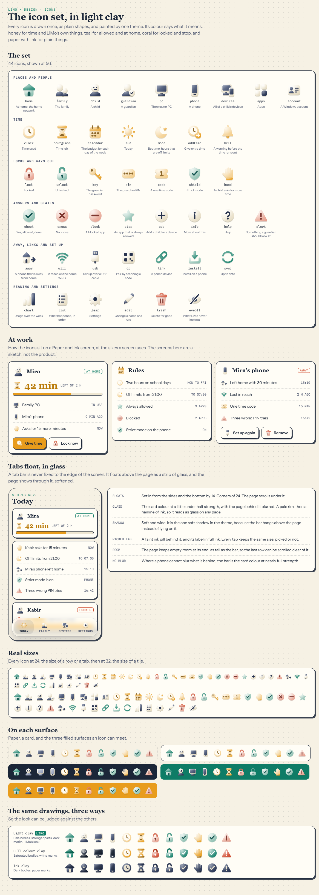
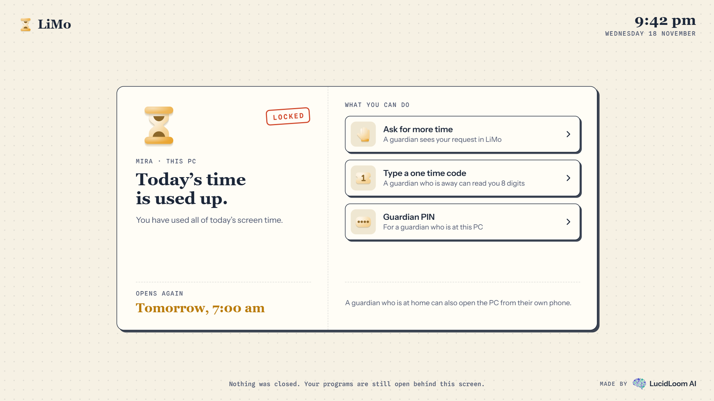
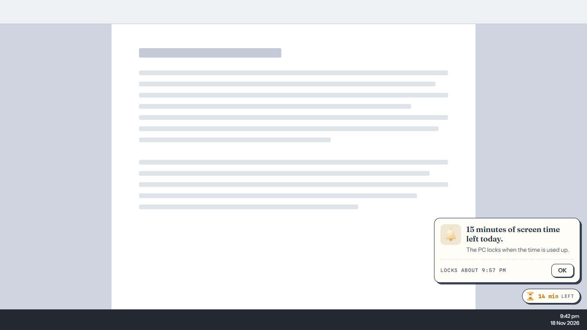

# LiMo design: Paper and Ink

Every LiMo screen follows one theme, called Paper and Ink. It is the theme
of the LucidLoom AI products, so LiMo looks like one of the family. This
folder holds the theme's values and LiMo's icons.

It covers every surface a family sees: the phone app, the guardian console
on the PC, the time left display and the lock screen.

```
tokens.json          the colours, type, corners, borders and shadows
icons/
  shapes.js          the drawings, as plain data
  clay.js            how a drawing is painted
  sheet.html         the review sheet: open it in a browser
  export.js          writes svg/ and ICONS.md
  svg/               every icon as its own file
  ICONS.md           every icon, with its colour and what it is for
  preview.png        a picture of the review sheet
screens/
  sheet.html         the review sheet for the PC: open it in a browser
  lock.html          the lock screen at its real size; it can be used
  time-left.html     the time left display on a plain desktop
  pc.js, pc.css      what those pages draw
```



## The theme

A page is warm paper with a faint dot grid. Text and lines are ink. A card
is a lighter paper with a thin ink border and a hard shadow set down and to
the right, as if it were cut out and laid on the page. Dividers inside a
card are dashed. A state is shown as a small stamp: mono capitals in an
outlined box.

| Value | Colour | Used for |
| --- | --- | --- |
| paper | `#f6f1e4` | the page |
| paper2 | `#efe7d2` | a quieter band, such as a tab bar |
| card | `#fffdf6` | cards and buttons |
| ink | `#1b2638` | text, borders, shadows |
| inkSoft | `#46506a` | secondary text |
| marigold | `#e89c1c` | time, and the things that are LiMo's own |
| marigoldDeep | `#b97a08` | marigold for text and large numbers |
| teal | `#0e7c66` | allowed, at home, connected, done |
| coral | `#cf4326` | locked, blocked, stop, danger |

Type: Fraunces for headings and large numbers, Instrument Sans for reading
text, Spline Sans Mono for labels, times and other data. All three are
published under the SIL Open Font License 1.1. The product bundles them,
each beside its licence, in `../screens/fonts/`, and the pages in this folder
load them from there, so they show the real type on any PC.

Shape: borders are 1.5 wide, corners are 7, 10 or 14, and the card shadow
is 4 across and 4 down with no blur. Spacing steps by 4.

## Rules

1. **Colour means something.** Marigold is time. Teal is allowed, at home
   or done. Coral is locked, blocked or dangerous. Everything else is ink
   on paper. Colour is never decoration.
2. **Plain facts and controls stay plain.** A choice, a setting or a number
   is an ink outline with mono type, not an illustration.
3. **Nothing changes size when it is picked.** A selected chip, a message
   that appears and a label that turns bold all keep the room they had.
4. **A tap shows a result.** After any tap, the settled screen must look
   different to someone who was not told what to expect.
5. **No emoji and no icon fonts.** Icons come from this set. Small marks
   beside text, such as arrows and ticks, are plain ink strokes.
6. **Every screen is checked at phone size and at desktop size,** for
   height as well as width, before it is called done.
7. **Tabs float, in glass.** A tab bar is never fixed to the edge of the
   screen. See below.
8. **The maker's mark is said once, at the end.** See below.

## The maker's mark

LiMo is made by LucidLoom AI, and its screens say so, quietly.

- **What it is.** The words "made by" in small mono capitals, the LucidLoom
  AI logo, and the name. The logo keeps its own colours and is never
  redrawn in the theme's. On a LiMo screen it is 26 high, and 22 on a phone.
- **Where it goes.** Once, at the end of a screen that fills the display:
  bottom right on the lock screen, and on the start and about screens of
  the app and the console. It is never the first thing on a screen; LiMo's
  own name is.
- **Where it does not go.** On small things that float over a child's own
  programs, such as the time left display and the notices.
- **On a lock screen it is not a link.** Nothing there opens anything.

The logo file is `../docs/images/lucidloom-logo.png`, the one at the top of
the repository's README.

## The tab bar

Where a screen has tabs, the bar floats above the page as a strip of
glass, and the page shows through it, softened. The review sheet shows one
on a sample phone screen.

- **It floats.** Set in from the sides and the bottom by 14, with corners
  of 24. The page scrolls under it.
- **It is glass.** The card colour at a little under half strength, with
  what is behind it blurred by 9. A pale rim, then a hairline of ink, so
  it reads as glass on any page.
- **Its shadow is soft and wide.** This is the one soft shadow in the
  theme, because the bar hangs above the page instead of lying on it.
- **The picked tab** has a faint ink pill behind it and its label in full
  ink. Every tab keeps the same size, picked or not.
- **The page keeps room at its end,** as tall as the bar, so the last row
  can be scrolled clear of it.
- **Where a phone cannot blur** what is behind, the bar is the card colour
  at nearly full strength instead.

## On the PC

What a child sees on the master PC: the lock screen, and the time left
display with its notices. Open `screens/sheet.html` for every state. Each
picture there opens at its real size, and the lock screen can be used: the
buttons do what they would do, against made up answers.



**The lock screen** is one card on the paper page. The left half says why
the PC is locked and when it opens again. The right half is what can be
done: ask a guardian for more time, type a code that a guardian reads out,
or a guardian types the PIN. The left half stays while a way out is open,
so the reason is never out of sight. The card never changes size.

- The picture is the reason: an hourglass for time used up, a moon for
  hours that are off limits, a lock for a guardian's lock. The stamp says
  LOCKED in coral, the one use of coral on the screen.
- The time it opens again is marigold, because it is a time.
- Digits can be typed or tapped. A message under a field has its room kept
  when there is none, so nothing moves when it appears.
- It shows only what LiMo itself knows. No picture of what is behind it,
  no list of programs, no window titles.
- Every other screen attached to the PC is covered too, and only says to
  look at the main one.



**The time left display** is one line that floats above everything, by the
clock: the time left, and whether it is being counted. It is solid, not
glass, because it has to be read over any program. A warning 15, 5 and 1
minute before a lock, and a notice when a blocked program is closed,
appear above it.

**Size.** Everything is laid out for a screen of 1366 by 768 and scaled as
one piece, by the smaller of width over 1366 and height over 768, kept
between 0.8 and 2.2.

These pages are drawings to agree the look. The real lock screen is drawn
by LiMo's helper in the child's session, not by a browser, and has to
match them.

## On the phone

What a child sees on an Android phone: the lock, the block screen, the
warning, and their own Today screen in the app. Open `screens/phone.html`
for every state, each drawn at its real size.

**The lock** says what the PC's lock says, stacked for an upright screen:
the reason card, then what can be done, then the apps that stay open. The
words are the PC's own, with "PC" changed to "phone" and "programs" to
"apps", and they come from the phone's engine, not from the screen.

- **A way out takes the whole screen.** Asking for time, a one time code
  and the guardian PIN each open as a screen of their own, because a phone
  has no room to set them beside the reason. The reason stays in sight as a
  strip at the top, and the main button is pinned to the bottom, above the
  keyboard when one is up.
- **Emergency call is pinned to the bottom of every lock and block
  screen,** so it is in sight even on a small phone that has to scroll. A
  lock never stands between a child and a call for help.
- **A call is never trapped and never a way around.** A ringing call is
  not covered. While a call is on, the phone app itself stays free, and the
  lock carries a teal "Back to the call" button above "Emergency call". It
  is the only teal on the screen.
- **The apps that stay open** are shown with their own icons and open from
  the lock. The drawings show letter tiles in their place.
- The maker's mark is 22 high on a phone, at the end of the scrolling part.

**The block screen** covers an app the family's rules block: one card that
names the app, and one button that goes to the home screen. Nothing is
closed.

**Today** is the child's own screen in the app: the time left, the time
used on this phone and on the PC, and the minutes per app, names and
minutes only. It never says "counting": looking at LiMo itself does not use
time, and the screen says so. Its two tabs float in glass.

**The warning** floats over the child's own app, as on the PC. The time
left is in Android's own notification, which Android draws.

**Setting up a phone** is drawn in `screens/phone-setup.html`. A guardian
holds the child's phone, which the family PC has just installed and paired
over the cable.

- One screen says what LiMo does on the phone, in three plain rows, and
  asks the guardian to agree. The button to go on stays switched off until
  the box is ticked.
- Then one screen for each thing Android has to grant: notifications,
  phone, usage access, accessibility, battery and protection. The phone
  step is there so that a lock never hides a call: LiMo learns that a call
  is ringing or on, never who is calling. Each screen says why LiMo needs
  it and what Android will show, and carries a stamp that reads NOT ON YET
  until Android itself says it is on. Nothing is taken on trust.
- Then three screens for the child: what LiMo counts, what it never looks
  at, and how to ask for more time. The same three are in the app's "How
  it works" tab, with the child's own rules.
- The words name the child and never say "her" or "him": the app knows a
  name, not how a child is spoken of.
- When something is switched off later, Today says so in a banner and
  sends for a guardian. It does not scold.

**Size.** Everything is laid out for a phone of 390 by 844 and checked on
one of 360 by 640, where the screen scrolls above the pinned buttons. No
text is smaller than 12, and nothing to tap is lower than 48.

The real screens are native Android views drawn by the app, not by a
browser, and have to match these drawings.

## The icons

The icons are light clay: soft rounded forms in pale tones, lit from the
top left, with a soft shadow and no outlines. Each icon has a lighter clay
for its body and a darker clay for its smaller parts. Marks on the lighter
clay are dark.

An icon takes one colour, by the rule above. A plain thing, such as a
device or a person, is paper and ink themselves: a cream body with ink
parts.

**To look at them,** open `icons/sheet.html` in a browser. Add `?close=1`
to the address for a close up of every drawing.

**To use one,** take its file from `icons/svg/`, or call `svg()` in
`clay.js` with the drawing from `shapes.js`. Sizes: 24 in a row or a tab,
32 on a tile, 48 beside a heading, 96 on an empty screen. On an ink
surface pass `on: 'dark'`, so the ink parts of a plain icon stay visible.

**To add one,** add a drawing to `shapes.js` and run `node export.js` in
the `icons` folder. The rules for a drawing are at the top of `shapes.js`:
a handful of chunky shapes, about 38 of the 48 units filled both ways so
every icon looks one size, every corner rounded, one colour. Then look at
it on the sheet at 24 before using it.

The drawings are data, not pictures, so the phone app and the console can
paint them with their own drawing code from the same file.
