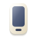
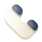
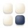
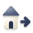
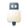
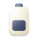
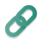
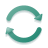
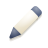
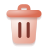

# LiMo icons

Written by `node export.js`. Do not edit by hand: change `shapes.js` and run it again.

47 icons.

| Name | Icon | Colour | What it is for |
| --- | --- | --- | --- |
| `home` |  | teal | At home, the home network |
| `family` |  | ink | The family |
| `child` |  | ink | A child |
| `guardian` |  | ink | A guardian |
| `pc` |  | ink | The master PC |
| `phone` |  | ink | A phone |
| `call` |  | ink | A call, ringing or on |
| `devices` |  | ink | All of a child’s devices |
| `apps` |  | ink | Apps |
| `account` |  | ink | A Windows account |
| `clock` |  | honey | Time used |
| `hourglass` |  | honey | Time left |
| `calendar` |  | honey | The budget for each day of the week |
| `sun` |  | honey | Today |
| `moon` |  | honey | Bedtime, hours that are off limits |
| `addtime` |  | honey | Give extra time |
| `bell` |  | honey | A warning before the time runs out |
| `lock` |  | coral | Locked |
| `unlock` |  | teal | Unlocked |
| `key` |  | honey | The guardian password |
| `pin` |  | honey | The guardian PIN |
| `code` |  | honey | A one time code |
| `shield` |  | teal | Strict mode |
| `hand` |  | honey | A child asks for more time |
| `check` |  | teal | Yes, allowed, done |
| `cross` |  | coral | No, close |
| `block` |  | coral | A blocked app |
| `star` |  | teal | An app that is always allowed |
| `add` |  | ink | Add a child or a device |
| `info` |  | ink | More about this |
| `help` |  | ink | Help |
| `alert` |  | coral | Something a guardian should look at |
| `away` |  | ink | A phone that is away from home |
| `wifi` |  | teal | In reach on the home Wi-Fi |
| `usb` |  | ink | Set up over a USB cable |
| `battery` |  | ink | The battery, and Android putting apps to sleep |
| `qr` |  | ink | Pair by scanning a code |
| `link` |  | teal | A paired device |
| `install` |  | teal | Install on a phone |
| `sync` |  | teal | Up to date |
| `chart` |  | ink | Usage over the week |
| `list` |  | ink | What happened, in order |
| `rules` |  | ink | A child’s rules, and the Rules tab |
| `gear` |  | ink | Settings |
| `edit` |  | ink | Change a name or a rule |
| `trash` |  | coral | Delete for good |
| `eyeoff` |  | ink | What LiMo never looks at |
